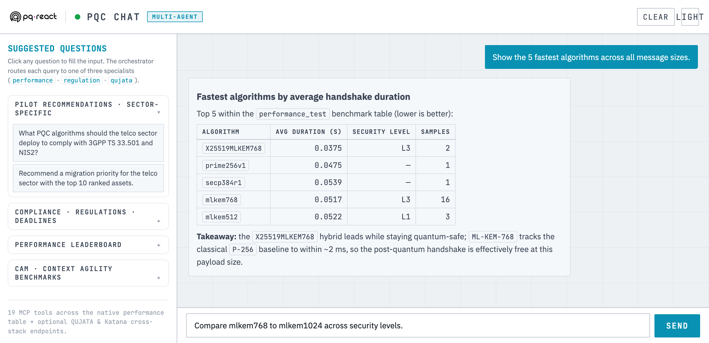
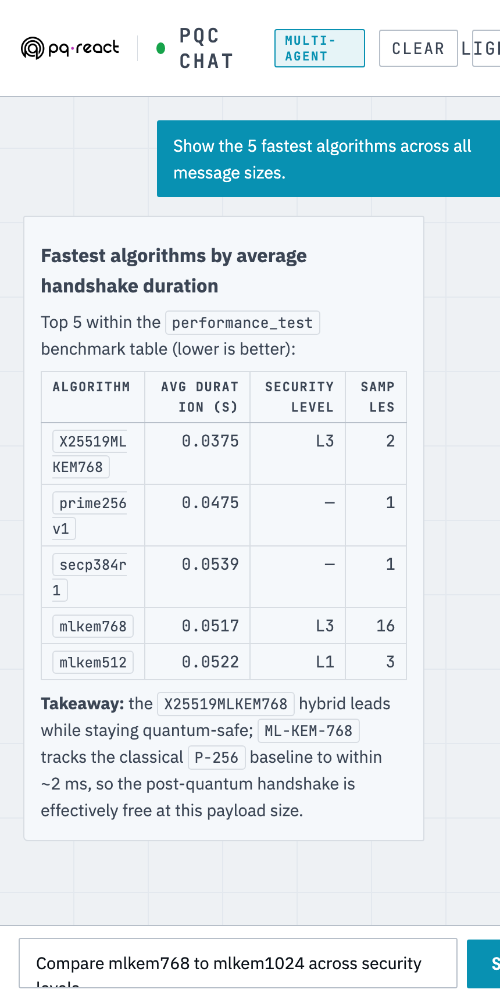

# PQ-REACT MCP Server

A standalone post-quantum-cryptography assistant that exposes a **Model Context Protocol (MCP)** server over SSE plus a small **FastAPI chat UI** backed by Ollama.

The server publishes 19 typed tools the chat agent can call: 10 over a local MariaDB benchmark table (`PQREACT.performance_test`), 3 over an optional QUJATA-TID test-suite database, and 6 over an optional Katana Slice Manager NBI + KPI collector. The cross-stack tools soft-fail when their endpoints aren't configured, so the server runs cleanly in isolation.

## Screenshots



The FastAPI chat UI in the light "operator console" theme. The sidebar offers routed example prompts; a question is answered by the agent calling typed MCP tools over the benchmark database and rendering the result as a table. The layout is responsive:

<p></p>

---

## What it is

- **`mcp-ollama_server/database/mariadb_mcp.py`** — FastMCP server with all tool registrations. Listens on `:5040/sse` by default.
- **`mcp-ollama_server/client_mcp/`** — FastAPI app on `:8081` with a single-page chat UI (`index.html` + `script.js` + `style.css`). Connects to the MCP server over SSE and to Ollama for the LLM.
- **`serve_sse.py`** — thin wrapper that imports `mariadb_mcp` (so all `@mcp.tool()` decorators run), then starts the SSE transport on the configured host/port.
- **Sample data** — `mcp-ollama_server/database/pqreact_export.sql` seeds 200+ rows so the chat works out of the box.

## Tools (19)

| Category | Tool | What it does |
|---|---|---|
| Native (MariaDB) | `query_by_algorithm` | All rows for one algorithm |
| | `query_by_message_size` | All rows for one message size |
| | `query_by_security_level` | NIST L1 / L3 / L5 filter |
| | `compare_algorithms` | Side-by-side perf comparison |
| | `get_fastest_algorithms` | Top-N by duration |
| | `get_lowest_power_for_size` | Cheapest by CPU power |
| | `get_lowest_energy_algorithms` | Top-N by energy |
| | `get_lowest_energy_for_size` | Energy rank at fixed size |
| | `query_available_sizes` | Distinct message sizes |
| | `execute_query` | Whitelisted raw SELECT |
| QUJATA cross-DB (env-gated) | `query_test_suite` | Joins a QUJATA test-suite + runs |
| | `get_latest_test_suite` | Most recent QUJATA suite |
| | `launch_qujata_experiment` | New QUJATA iperf run (hard caps: 60 s, 200 Mbps, 8 conns) |
| Katana NBI / KPI (env-gated) | `katana_list_slices` | List slices via NBI |
| | `katana_get_slice` | Slice detail by id |
| | `katana_create_slice` | Off by default; needs `KATANA_ALLOW_CREATE=true` |
| | `katana_delete_slice` | Off by default; needs `KATANA_ALLOW_DELETE=true` |
| | `katana_kpi_events` | Last N UC3 KPI events |
| | `katana_kpi_stats` | Aggregated KPI stats |

The chat agent (`client.py`) routes user questions through these tools using Ollama's structured tool-calling. A hardened text-leak parser also rescues tool calls that smaller models emit as plain text (`<tool_call>`, `<|tool_call|>`, or inline JSON).

---

## Prerequisites

- **Docker** and **Docker Compose v2** — for the server stack (MariaDB + MCP SSE).
- **Python 3.11+** — only if you run the chat client outside Docker.
- **[Ollama](https://ollama.com)** with a tool-capable model pulled. Default is `glm-4.7-flash:q4_K_M`; any structured-tool-calling model works (e.g. `llama3.1:8b`, `qwen2.5:7b`). The client reaches it via `OLLAMA_HOST` (default `http://localhost:11434`).
- Network reach from the chat client to the MCP server's `:5040/sse` and to Ollama's `:11434`.

QUJATA and Katana integrations are optional and env-gated — the server runs fully without them.

## Quickstart — server stack (MariaDB + MCP SSE)

Single Docker compose, single host:

```bash
cp .env.example .env
# edit .env: at minimum set MCP_DB_ROOT_PW + MCP_DB_PW
docker compose up -d
# A fresh volume is initialised automatically: the seed dump
# (mcp-ollama_server/database/pqreact_export.sql) followed by
# etl/schema/*.sql (schema only). To re-seed an existing volume by hand,
# load the dump and then re-apply etl/schema/performance_test.sql — the
# dump drops and recreates performance_test without the `source` /
# `size_kind` columns the server needs:
#   for f in mcp-ollama_server/database/pqreact_export.sql etl/schema/performance_test.sql; do
#     docker exec -i pqreact-mcp-mariadb \
#       sh -c 'mariadb -uroot -p"$MARIADB_ROOT_PASSWORD" PQREACT' < "$f"
#   done
# probe
curl -fsS http://localhost:5040/sse | head -c 200 ; echo
```

Or push to a remote host with the bundled installer:

```bash
SSHPASS='<your-vm-password>' ./deploy/install-server.sh <mcp-server-host> <ssh-user>
```

That will rsync the stack to `/opt/pqreact-mcp-server/`, generate random DB passwords on first run, build the image, and start everything.

## Quickstart — chat client (FastAPI + Ollama)

The chat UI is a Python venv + systemd unit; it expects Ollama on the same host.

```bash
SSHPASS='<your-vm-password>' ./deploy/install-client.sh <gpu-vm-host> <ssh-user>
```

This installs to `/opt/pqreact-mcp-client/`, creates a venv, drops `systemd/pqreact-mcp-client.service` into `/etc/systemd/system/`, and starts uvicorn on `:8081`. Open `http://<host>:8081/` and chat.

## Cross-stack reach (optional)

The QUJATA and Katana tools are off by default. Wire them by setting env vars in `.env` before bringing up the server:

```bash
QUJATA_DB_HOST=qujata-mysql
QUJATA_API_BASE=http://qujata-api:3020/qujata-api
KATANA_NBI_BASE=http://<katana-nbi-host>:8000/api
KATANA_KPI_BASE=http://<katana-kpi-host>:8080
```

When these are unset, the corresponding tools still register but return a soft `"… unreachable"` error if called — the agent simply skips them.

---

## Configuration reference

All vars are read at server start (`mariadb_mcp.py`) or client start (`api.py`/`client.py`). See `.env.example` for the full list.

| Var | Used by | Default | What |
|---|---|---|---|
| `DB_HOST` / `DB_PORT` / `DB_NAME` / `DB_USER` / `DB_PASSWORD` | server | — / — / `PQREACT` / `pqreact` / **(required)** | MariaDB connection. Server refuses to start with a blank password. |
| `MCP_BIND_HOST` / `MCP_BIND_PORT` | server | `0.0.0.0` / `5040` | SSE bind. |
| `QUJATA_DB_*` | server | unset | Cross-DB into QUJATA's MySQL. |
| `QUJATA_API_BASE` | server | unset | Used by `launch_qujata_experiment`. |
| `KATANA_NBI_BASE` | server | unset | Katana NBI base (e.g. `http://host:8000/api`). |
| `KATANA_KPI_BASE` | server | unset | KPI collector (`/api/events`, `/api/stats`). |
| `KATANA_ALLOW_CREATE` / `KATANA_ALLOW_DELETE` | server | `false` | Mutating slice tools, off by default. |
| `KATANA_HTTP_TIMEOUT` | server | `10` | Outbound HTTP timeout (seconds). |
| `OLLAMA_HOST` / `OLLAMA_MODEL` | client | `http://localhost:11434` / `glm-4.7-flash:q4_K_M` | LLM endpoint and model. |
| `MCP_SERVER_URL` | client | `http://localhost:5040/sse` | Where the chat client should connect. |
| `MCP_API_PORT` | client | `8081` | FastAPI port. |

## Repository layout

```
.
├── README.md                         (this file)
├── .env.example
├── docker-compose.yml                (server stack)
├── Dockerfile.server                 (FastMCP SSE)
├── Dockerfile.client                 (FastAPI chat UI — optional)
├── serve_sse.py                      (SSE wrapper for mariadb_mcp)
├── requirements-server.txt
├── requirements-client.txt
├── systemd/
│   └── pqreact-mcp-client.service
├── deploy/
│   ├── install-server.sh
│   └── install-client.sh
└── mcp-ollama_server/
    ├── client_mcp/                   (chat UI: api.py, client.py, index.html, script.js, style.css)
    └── database/                     (mariadb_mcp.py, pqreact_export.sql, setup_db.sh)
```

## Origin

Developed within the **PQ-REACT** project. The code in `mcp-ollama_server/` builds on the upstream MCP-Ollama tree with a series of absorbed patches (env-driven config, tool-using agent, QUJATA cross-tools, Katana cross-tools, UI polish, bug fixes).

## License

Licensed under the **European Union Public Licence v. 1.2 (EUPL-1.2)** — see [`LICENSE`](LICENSE).

`SPDX-License-Identifier: EUPL-1.2`

Copyright (c) 2024–2026 NCSR "Demokritos" (core-ncsrd) and the PQ-REACT consortium.
